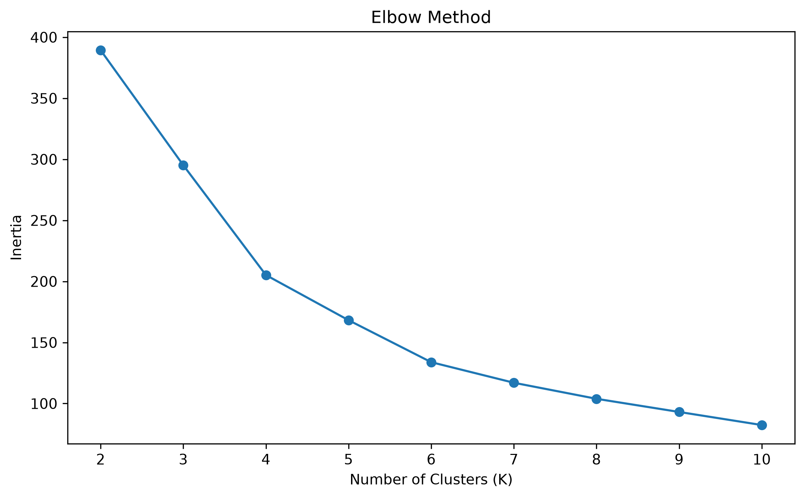
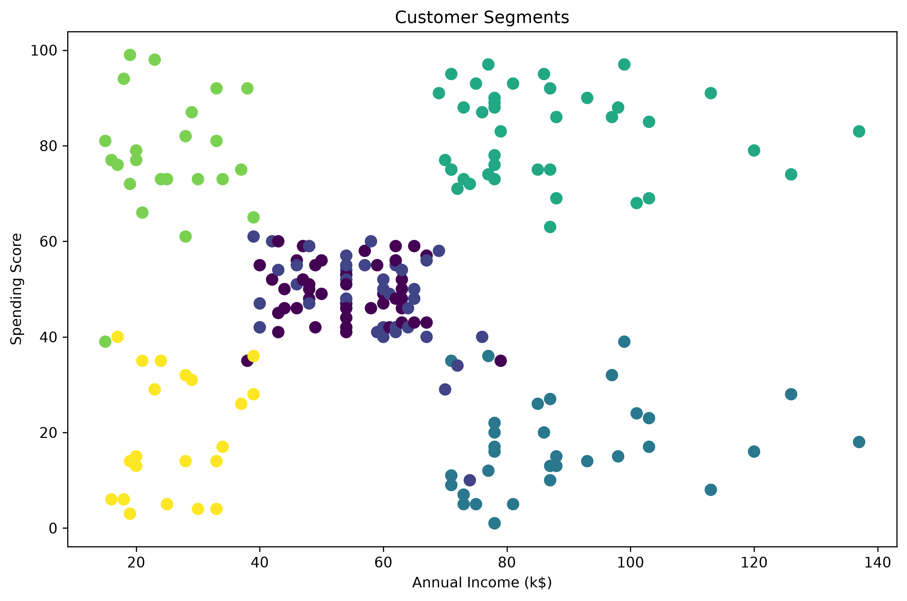
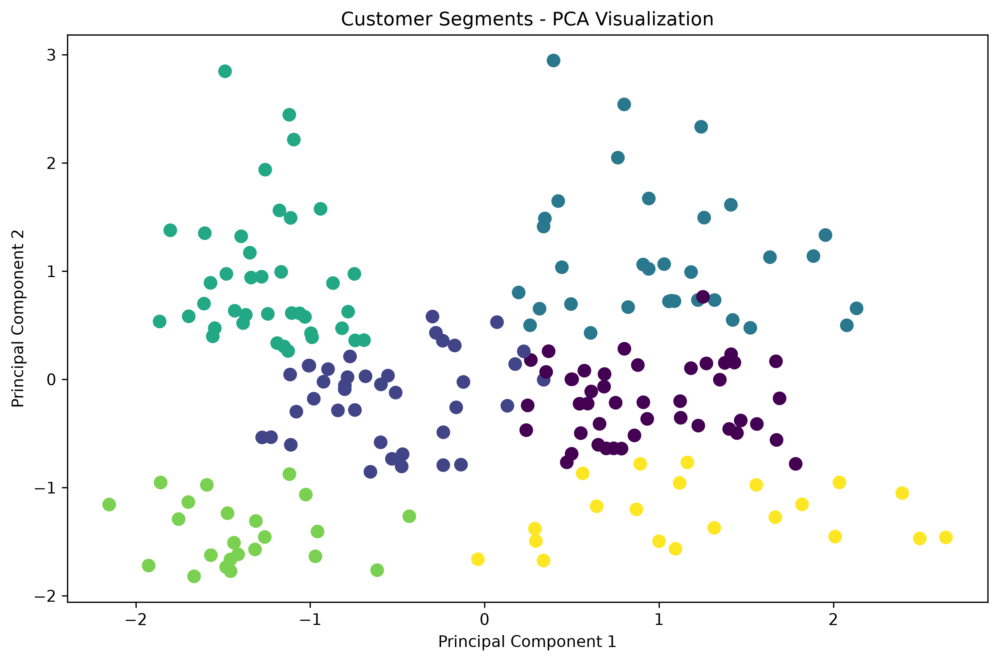

# Customer Segmentation Using K-Means Clustering

An unsupervised machine learning project that uses **K-Means clustering** to identify customer segments based on age, annual income, and spending behavior.

## Project Overview

Customer segmentation is the process of grouping customers with similar characteristics and behaviors.

In this project, K-Means clustering is used to discover customer groups without using a predefined target variable.

The project evaluates different numbers of clusters using the **Elbow Method** and **Silhouette Score**, then analyzes the resulting customer segments.

## Objectives

* Explore customer demographic and spending data
* Select relevant features for clustering
* Standardize numerical features
* Determine a suitable number of clusters
* Apply K-Means clustering
* Analyze the characteristics of each customer segment
* Visualize the clusters
* Use PCA to visualize the clusters in two dimensions

## Dataset

The project uses the **Mall Customers** dataset containing 200 customer records.

The main features used for clustering are:

* **Age**
* **Annual Income (k$)**
* **Spending Score (1-100)**

`CustomerID` was excluded because it is an identifier rather than a meaningful clustering feature.

The initial clustering analysis focuses on numerical demographic and spending characteristics.

## Machine Learning Approach

### K-Means Clustering

K-Means is an unsupervised learning algorithm that divides observations into a specified number of clusters.

The algorithm assigns each customer to the cluster whose center is closest to that customer's feature values.

Because the features have different scales, **StandardScaler** was used before applying K-Means.

### Choosing the Number of Clusters

Two methods were used to evaluate different values of K:

1. Elbow Method
2. Silhouette Score

### Elbow Method

The Elbow Method examines the decrease in within-cluster inertia as the number of clusters increases.



### Silhouette Score

The Silhouette Score measures how well-separated the resulting clusters are.

The tested values produced the following results:

|     K | Silhouette Score |
| ----: | ---------------: |
|     2 |         0.335472 |
|     3 |         0.357793 |
|     4 |         0.403958 |
|     5 |         0.416643 |
| **6** |     **0.428417** |
|     7 |         0.417232 |
|     8 |         0.408207 |
|     9 |         0.417693 |
|    10 |         0.406554 |

Among the tested values, **K = 6** produced the highest silhouette score.

## Customer Segmentation Results

The final K-Means model used **6 clusters**.



The resulting customer segments were summarized using their average age, annual income, and spending score.

| Cluster | Customers | Avg Age | Avg Income | Avg Spending |
| ------: | --------: | ------: | ---------: | -----------: |
|       0 |        45 |   56.33 |      54.27 |        49.07 |
|       1 |        39 |   26.79 |      57.10 |        48.13 |
|       2 |        33 |   41.94 |      88.94 |        16.97 |
|       3 |        39 |   32.69 |      86.54 |        82.13 |
|       4 |        23 |   25.00 |      25.26 |        77.61 |
|       5 |        21 |   45.52 |      26.29 |        19.38 |

### Segment Interpretation

* **Cluster 0:** Older customers with moderate income and moderate spending.
* **Cluster 1:** Younger customers with moderate income and moderate spending.
* **Cluster 2:** Middle-aged customers with high income and low spending.
* **Cluster 3:** Younger customers with high income and high spending.
* **Cluster 4:** Younger customers with low income and high spending.
* **Cluster 5:** Middle-aged customers with low income and low spending.

These descriptions are based on the average characteristics of each cluster.

## PCA Visualization

Principal Component Analysis (PCA) was used to reduce the three standardized features to two dimensions for visualization.

PCA was **not** used to train the K-Means model. The clustering model was trained using the original three standardized features.

The first two principal components explained approximately **77.57% of the total variance**.



This two-dimensional representation preserves a substantial portion of the information in the original dataset while allowing the clusters to be visualized more easily.

## Key Findings

* The dataset contains **200 customer records**.
* Three numerical features were used for clustering.
* The features were standardized before applying K-Means.
* Values of K from **2 to 10** were evaluated.
* **K = 6** produced the highest silhouette score among the tested values.
* The six clusters showed different combinations of age, income, and spending behavior.
* PCA explained approximately **77.57%** of the variance using its first two components.

## Technologies

* Python
* Pandas
* NumPy
* Matplotlib
* Scikit-learn
* Jupyter Notebook

## Project Structure

```text
customer-segmentation/
│
├── data/
│   └── Mall_Customers.csv
│
├── images/
│   ├── elbow_method.png
│   ├── silhouette_score.png
│   ├── customer_segments.png
│   └── pca_clusters.png
│
├── customer_segmentation.ipynb
├── README.md
├── requirements.txt
└── .gitignore
```

## How to Run

### 1. Clone the repository

```bash
git clone https://github.com/Rajesh-code11/customer-segmentation.git
```

### 2. Navigate to the project

```bash
cd customer-segmentation
```

### 3. Install the required packages

```bash
pip install -r requirements.txt
```

### 4. Open the notebook

```bash
jupyter notebook
```

Then open:

```text
customer_segmentation.ipynb
```

## What I Learned

Through this project, I practiced:

* Unsupervised machine learning
* K-Means clustering
* Feature scaling with StandardScaler
* The Elbow Method
* Silhouette Score
* Cluster interpretation
* PCA for dimensionality reduction and visualization
* Data exploration and visualization with Pandas and Matplotlib
* Organizing a machine learning project for GitHub

## Conclusion

This project demonstrates how K-Means clustering can be used to discover customer segments without predefined target labels.

By combining clustering evaluation methods, feature scaling, visualization, and cluster analysis, the project identifies six distinct groups with different demographic and spending characteristics.
# Customer Segmentation Using K-Means Clustering

An unsupervised machine learning project that uses **K-Means clustering** to identify customer segments based on age, annual income, and spending behavior.

## Project Overview

Customer segmentation is the process of grouping customers with similar characteristics and behaviors.

In this project, K-Means clustering is used to discover customer groups without using a predefined target variable.

The project evaluates different numbers of clusters using the **Elbow Method** and **Silhouette Score**, then analyzes the resulting customer segments.

## Objectives

* Explore customer demographic and spending data
* Select relevant features for clustering
* Standardize numerical features
* Determine a suitable number of clusters
* Apply K-Means clustering
* Analyze the characteristics of each customer segment
* Visualize the clusters
* Use PCA to visualize the clusters in two dimensions

## Dataset

The project uses the **Mall Customers** dataset containing 200 customer records.

The main features used for clustering are:

* **Age**
* **Annual Income (k$)**
* **Spending Score (1-100)**

`CustomerID` was excluded because it is an identifier rather than a meaningful clustering feature.

The initial clustering analysis focuses on numerical demographic and spending characteristics.

## Machine Learning Approach

### K-Means Clustering

K-Means is an unsupervised learning algorithm that divides observations into a specified number of clusters.

The algorithm assigns each customer to the cluster whose center is closest to that customer's feature values.

Because the features have different scales, **StandardScaler** was used before applying K-Means.

### Choosing the Number of Clusters

Two methods were used to evaluate different values of K:

1. Elbow Method
2. Silhouette Score

### Elbow Method

The Elbow Method examines the decrease in within-cluster inertia as the number of clusters increases.


### Silhouette Score

The Silhouette Score measures how well-separated the resulting clusters are.

The tested values produced the following results:

|     K | Silhouette Score |
| ----: | ---------------: |
|     2 |         0.335472 |
|     3 |         0.357793 |
|     4 |         0.403958 |
|     5 |         0.416643 |
| **6** |     **0.428417** |
|     7 |         0.417232 |
|     8 |         0.408207 |
|     9 |         0.417693 |
|    10 |         0.406554 |

Among the tested values, **K = 6** produced the highest silhouette score.

## Customer Segmentation Results

The final K-Means model used **6 clusters**.


The resulting customer segments were summarized using their average age, annual income, and spending score.

| Cluster | Customers | Avg Age | Avg Income | Avg Spending |
| ------: | --------: | ------: | ---------: | -----------: |
|       0 |        45 |   56.33 |      54.27 |        49.07 |
|       1 |        39 |   26.79 |      57.10 |        48.13 |
|       2 |        33 |   41.94 |      88.94 |        16.97 |
|       3 |        39 |   32.69 |      86.54 |        82.13 |
|       4 |        23 |   25.00 |      25.26 |        77.61 |
|       5 |        21 |   45.52 |      26.29 |        19.38 |

### Segment Interpretation

* **Cluster 0:** Older customers with moderate income and moderate spending.
* **Cluster 1:** Younger customers with moderate income and moderate spending.
* **Cluster 2:** Middle-aged customers with high income and low spending.
* **Cluster 3:** Younger customers with high income and high spending.
* **Cluster 4:** Younger customers with low income and high spending.
* **Cluster 5:** Middle-aged customers with low income and low spending.

These descriptions are based on the average characteristics of each cluster.

## PCA Visualization

Principal Component Analysis (PCA) was used to reduce the three standardized features to two dimensions for visualization.

PCA was **not** used to train the K-Means model. The clustering model was trained using the original three standardized features.

The first two principal components explained approximately **77.57% of the total variance**.


This two-dimensional representation preserves a substantial portion of the information in the original dataset while allowing the clusters to be visualized more easily.

## Key Findings

* The dataset contains **200 customer records**.
* Three numerical features were used for clustering.
* The features were standardized before applying K-Means.
* Values of K from **2 to 10** were evaluated.
* **K = 6** produced the highest silhouette score among the tested values.
* The six clusters showed different combinations of age, income, and spending behavior.
* PCA explained approximately **77.57%** of the variance using its first two components.

## Technologies

* Python
* Pandas
* NumPy
* Matplotlib
* Scikit-learn
* Jupyter Notebook

## Project Structure

```text
customer-segmentation/
│
├── data/
│   └── Mall_Customers.csv
│
├── images/
│   ├── elbow_method.png
│   ├── silhouette_score.png
│   ├── customer_segments.png
│   └── pca_clusters.png
│
├── customer_segmentation.ipynb
├── README.md
├── requirements.txt
└── .gitignore
```

## How to Run

### 1. Clone the repository

```bash
git clone https://github.com/Rajesh-code11/customer-segmentation.git
```

### 2. Navigate to the project

```bash
cd customer-segmentation
```

### 3. Install the required packages

```bash
pip install -r requirements.txt
```

### 4. Open the notebook

```bash
jupyter notebook
```

Then open:

```text
customer_segmentation.ipynb
```

## What I Learned

Through this project, I practiced:

* Unsupervised machine learning
* K-Means clustering
* Feature scaling with StandardScaler
* The Elbow Method
* Silhouette Score
* Cluster interpretation
* PCA for dimensionality reduction and visualization
* Data exploration and visualization with Pandas and Matplotlib
* Organizing a machine learning project for GitHub

## Conclusion

This project demonstrates how K-Means clustering can be used to discover customer segments without predefined target labels.

By combining clustering evaluation methods, feature scaling, visualization, and cluster analysis, the project identifies six distinct groups with different demographic and spending characteristics.
